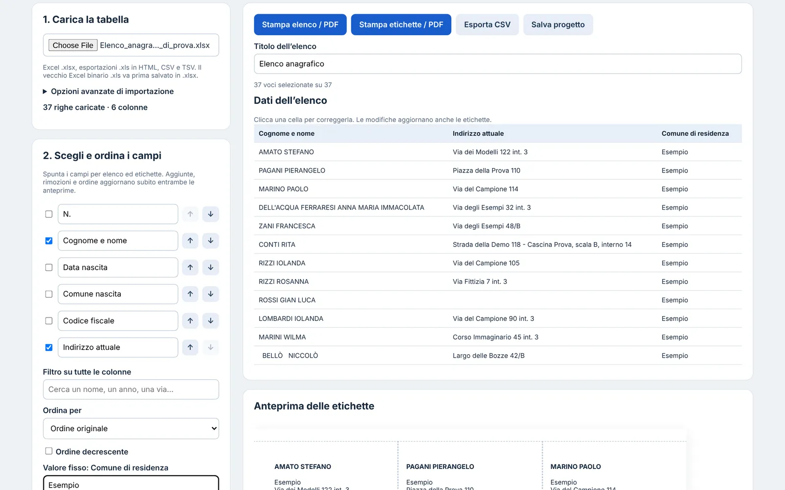
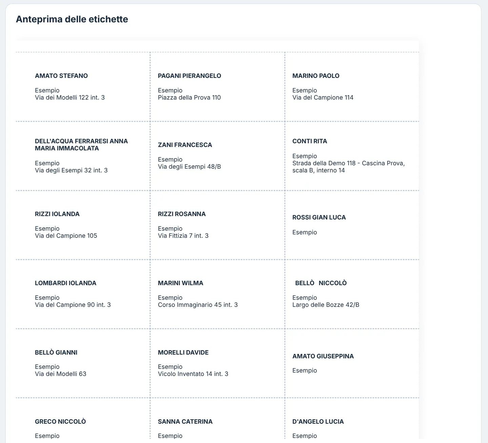

# Etichette

Da qualsiasi tabella a fogli di etichette A4 allineati al millimetro, direttamente nel browser.

> **Versione pubblica ripulita.** Codice, dati di prova, schermate e descrizioni sono stati controllati e ripuliti da dati sensibili: nomi, indirizzi, account, matricole, recapiti e credenziali sono inventati, e non ci sono riferimenti interni reali. Lo stemma dell'ente non è incluso.

| | |
|---|---|
| Categoria | Automazione documentale |
| Contesto | Stage del 4° anno al Comune di Verolanuova |
| Stato | Realizzato durante lo stage |
| Tecnologie | HTML, JavaScript, Excel, CSV |
| Demo | Inclusa, con dati inventati |

## Dal caos all'ordine

**Prima:** Tabelle di formati diversi, con l'intestazione nella riga sbagliata.

**Dopo:** Fogli A4 da 24 etichette, pronti per la stampa.

## Contesto

In ufficio servono spesso etichette per buste e pratiche, partendo da elenchi esportati da programmi diversi.

## Il problema

Ogni elenco arrivava in un formato diverso e andava sistemato a mano in un documento di testo, con il rischio di etichette sfalsate rispetto al foglio adesivo.

## La soluzione

Una pagina HTML che funziona senza Internet: legge XLSX, CSV, TSV e le esportazioni .xls in HTML, trova la riga delle intestazioni, fa scegliere campi e testo e impagina le etichette sul formato del foglio in uso.

## Come funziona

1. Tabella
2. Foglio e intestazione
3. Campi e testo
4. Formato del foglio
5. Anteprima
6. Stampa o PDF

## Funzioni principali

- XLSX, CSV, TSV ed esportazioni .xls in HTML
- Scelta del foglio e della riga di intestazione
- Campi, testo fisso e ordine configurabili
- A4 da 24 etichette (3 × 8, 70 × 36 mm) oppure 99,1 × 34 mm
- Misure, margini e passo regolabili per altri fogli
- Elenco in PDF, CSV e progetto salvato in JSON

## Casi inclusi nella demo

- Un Excel con titolo sopra le intestazioni, due fogli e 37 righe
- Nomi e indirizzi lunghissimi, un indirizzo vuoto, spazi in eccesso e un duplicato
- Un CSV con punto e virgola, un TSV e un finto .xls che contiene una tabella HTML

## Privacy

- Il file non lascia il computer: tutto avviene nel browser.
- Il programma non contiene dati: quelli della demo sono inventati.

## Limiti

- Le formule dell'Excel non vengono ricalcolate.
- I vecchi .xls binari vanno prima salvati in XLSX.
- Serve una stampa di prova su carta comune.

## Schermate

Schermate della versione dimostrativa, con dati inventati.

_Tabella di prova caricata: intestazione trovata alla seconda riga._

_Anteprima del foglio A4 da 24 etichette._

## Provarlo

Apri `Etichette_Locali.html` in Chrome, Edge o Brave e carica una delle tabelle in `Dati_di_prova`. Nessuna installazione.

La demo pronta da scaricare, in un unico ZIP, è nella cartella [`demo/`](demo/).

**Verificato:** Le quattro tabelle di prova caricate in Chrome su Linux, con intestazioni riconosciute e nessun errore.

**Non verificato:** Stampa su fogli adesivi non provata con i dati di prova.

---

Parte del [portfolio dei progetti di stage](https://github.com/Shad272/portfolio) di Angelo Erik Scontrino.
